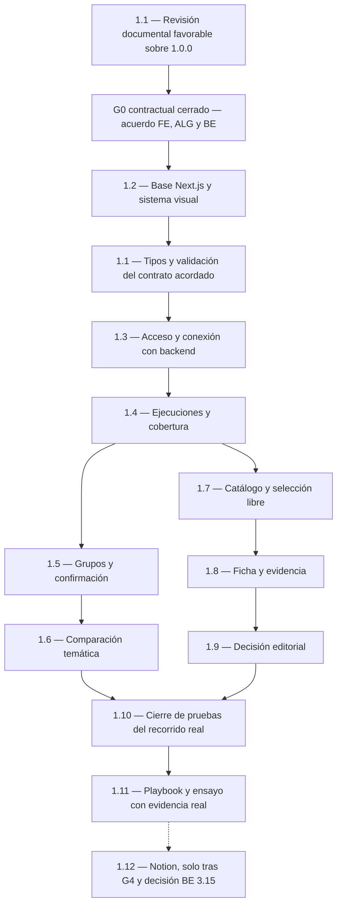

# Plan de frontend de SENIALON

**Responsable confirmado:** tú, como integrante FE del equipo. **Estado:** contrato único **`1.0.0`**, G0 contractual cerrado, FE 1.2 y los dos hitos de FE 1.1 completos. FE 1.3 tiene [acceso/transporte implementados y probados localmente](../frontend/ACCESO.md), con FastAPI real y binding de Services. El usuario confirmó después un proyecto Vercel Hobby de albcamargo con despliegue nativo desde `main`; su cierre conserva pendiente comprobar la URL protegida y sus servicios. El [control de presupuesto](budget/README.md) sigue bloqueando pruebas pagadas mientras falte verificar las cuentas. La entrega es el 18 de octubre de 2026 antes de las 12:00, America/Bogota; no se asignan duraciones sin disponibilidad confirmada.

Las doce tareas y sus casillas siguen en [tasks.md](../openspec/changes/definir-mvp-senialon/tasks.md). Este documento prepara su prioridad, dependencias y orden; no crea otra lista de estados ni cambia sus IDs. Referencias: [plan del equipo](PLAN_DE_TRABAJO.md), [diseño técnico](../openspec/changes/definir-mvp-senialon/design.md), [C4](ARQUITECTURA_C4.md) y [DESIGN.md](../DESIGN.md).

## Por cuál empezar

**Avance autorizado de 1.4:** la [interfaz de ejecuciones y cobertura](../frontend/EJECUCIONES.md) ya está implementada sobre el contrato. Sus escenarios de dominio son sintéticos; el backend actual solo ofrece metadatos. Para cerrar 1.4, integrar las operaciones, persistencia, cobertura y pasos BE 3.5/3.9/3.10/3.11 y las ventanas ALG 2.2, además del despliegue protegido. La casilla sigue abierta; preparar interfaz no acredita datos reales ni recuperación duradera.

**Continuidad preparada:** ALG 2.2/2.5/2.6 ya entrega funciones puras de ventanas, conteos y comparación; BE debe integrarlas y persistir sus contextos. La [inspección/confirmación FE 1.5](../frontend/GRUPOS.md) tiene interfaz y acciones locales, con integración BE 3.11/3.12 y ALG 2.3/2.4 aún pendientes. Sus dos pruebas corregidas no se marcan aprobadas: el reintento solicitado fue rechazado. Priorizar las entregas reales de backend para cerrar los recorridos preparados.

La [comparación temática FE 1.6](../frontend/COMPARACION.md) también tiene interfaz y acciones verificadas localmente: A/B, cobertura, base cero, desconocidos y respaldo por canal. Sus ocho pruebas nuevas de navegador son una suite independiente; no acreditan los reintentos pendientes de FE 1.5 ni el recorrido con persistencia y servicios reales. La casilla original conserva ese cierre integrado pendiente.

El [catálogo y selección FE 1.7](../frontend/PUBLICACIONES.md) está preparado y verificado localmente sin depender de 1.5–1.6. Incluye paginación, inspección, distinción candidato/Short, selección explícita sin análisis y recuperación de selecciones guardadas. Sus 13 pruebas nuevas de navegador son independientes; el cierre integrado con adquisición, pertinencia y persistencia auténticas de BE 3.8–3.11/ALG 2.3 sigue pendiente. FE 1.8 puede construirse sobre la identidad de selección, sin dar por probado el audiovisual real.

La autorización posterior implementa la [ficha FE 1.8](../frontend/FICHA.md) sobre esa identidad: URL y versión recuperables, ocho bloques separados, evidencia temporal y revisión visible, insuficiencias y fallas conservando datos. Consulta por GET y avance de una unidad explícito, sujeto a capacidades vigentes y presupuesto; recuperación de operaciones sin reenvío automático. La entrega pasó 534 Vitest (54 nuevas) y 14 Playwright nuevos exclusivos de FE 1.8. Su casilla sigue abierta por el recorrido auténtico de ALG 2.7–2.9 y BE 3.7/3.10/3.11, persistencia y despliegue protegido.

La autorización siguiente implementa el [registro editorial FE 1.9](../frontend/REVISION_EDITORIAL.md): decisión, motivo y revisión de evidencia sobre versión/revisión exactas, confirmación contractual de guardado y borrador conservado ante fallos. Recuperación por GET y reenvío manual idéntico, sin sobrescritura automática. Pasan 576 Vitest (42 nuevas), 18 Playwright nuevos exclusivos, typecheck/lint/build y 74 ejemplos tipados. Una prueba separada de la API Python con PostgreSQL temporal verifica revisión, conflictos y recuperación al recrear la aplicación con proveedores simulados. **La siguiente implementación es FE 1.10** para integrar y verificar el recorrido; el cierre de 1.9 con Next–Python desplegado y persistencia del equipo sigue pendiente, sin dar por cerradas BE 3.5/3.12 por estas pruebas.

**Cerrar 1.3 en despliegue:** su implementación local ya incluye comprobaciones independientes en páginas/handlers, validación de entradas/salidas, origen y transporte por binding. Pasan 326 pruebas unitarias, 9 Playwright y 6 comprobaciones de Services. El proyecto ya fue creado/vinculado según el usuario; BE conserva la verificación de límites/margen de cuenta y secretos de 3.6, y FE debe comprobar la URL protegida. Las operaciones de datos de 1.4 siguen dependiendo de las entregas BE/ALG indicadas abajo.

**Avance FE 1.10:** la [suite integrada nueva](../frontend/INTEGRACION.md) pasa cuatro casos con navegador, Next, FastAPI y PostgreSQL temporal: recorrido completo, fallo de canal, timeout audiovisual y acceso/origen. Guarda revisión desde UI y recupera la misma ficha/evidencia tras reiniciar el proceso Python y abrir otro contexto de navegador; GET no repite proveedores. Se conservan 576 Vitest y 74 ejemplos tipados; Python pasa 325 con tres omitidas sin PostgreSQL. Las respuestas de proveedores son sintéticas e interceptadas. La comprobación desplegada posterior obtiene raíz y metadatos 200 con acceso válido, pero /api/v1/runs devuelve 500 INTERNAL_ERROR. El usuario confirma que DATABASE_URL y migración todavía no están preparadas en despliegue: esa persistencia y repetir la lectura son el primer bloqueo por resolver. Faltan también cuentas/costos reales y prueba desde otro equipo físico; el acceso publicado en el README debe revisarse con BE. BE debe resolver además la continuidad del corpus ante una resolución de canal incierta, que hoy detiene nuevos pasos. Esas dependencias tienen prioridad sobre nuevas pantallas; FE 1.11 puede preparar el playbook sin declarar resueltos estos pendientes.

Tras la inspección inicial sin contrato se preparó draft.1 y se emitió la [revisión FE](REVISION_CONTRATO_FRONTEND.md) de diez necesidades, veinte casos y ocho observaciones. Draft.2 incorporó H01–H04; son antecedentes preservados en el contrato activo [1.0.0](contracts/README.md), SHA-256 `d7e0b018263658e686da00997ddffbd19ba96e6e73de5b08e3f8917b95375956`, con 94 esquemas y 74 ejemplos sintéticos. La [revisión semántica](REVISION_SEMANTICA_ALG.md) y las [interfaces ALG–BE](INTERFACES_ANALISIS.md) cierran el acuerdo documental, sin atribuir una firma a otros integrantes ni acreditar calidad empírica o implementación.

El [patch de 46 cambios](FE_1_1_CAMBIOS_PROPUESTOS.patch.json) fue aplicado por autorización del usuario en draft.2 y sus resoluciones se conservan en 1.0.0. Queda como registro histórico sobre la base draft.1: **no volver a aplicarlo sobre draft.2 ni 1.0.0**. El segundo borrador remoto fue retirado del árbol activo con [registro y referencia Git](../openspec/contract/README.md); la comparación inicial se conserva como antecedente. Los tipos proyectados para comprobar el contrato no completan el segundo hito técnico de 1.1.

Para evitar un ciclo, **1.1 tiene dos hitos dentro de la misma tarea**:

- **Revisión documental:** inventario, ejemplos, campos, estados y conformidad de FE sobre el borrador. Esto es lo que necesita el cierre del contrato G0; no requiere código ni crear tipos TypeScript.
- **Consumo técnico:** después de 1.2, preparar tipos y validación de respuestas del contrato acordado y comprobar su consumo. La casilla 1.1 se completa al verificar ambos hitos; no tiene que estar marcada completa para cerrar G0.

La base **1.2** conserva el sistema visual confirmado y aplica el parche Next.js 16.3.8 sin cambiar React o TypeScript. No necesita APIs operativas. Las pruebas pagadas mantienen como requisito la verificación pendiente de BE 3.2 y las llamadas de la aplicación BE 3.10; el build de frontend no habilita esos consumos.

## Prioridad y orden recomendado

- **P0 — Desbloqueo y verificación:** habilita el trabajo posterior o comprueba que el recorrido funciona. Obligatorio.
- **P1 — Núcleo y entrega:** funcionalidad editorial y materiales exigidos para la demo. También obligatorio; no significa prescindible.
- **P2 — Extensión:** Notion, únicamente si cabe después del núcleo, evaluación y preparación de entrega.

| Orden sugerido | Prioridad | Tarea existente | Resultado que debes entregar |
| --- | --- | --- | --- |
| 1 | P0 | 1.1, revisión documental | Revisión favorable sobre 1.0.0, H01–H04 preservados y acuerdo ALG/BE documentado; G0 contractual cerrado. |
| 2 | P0 | 1.2, base frontend | Next.js/App Router, React, TypeScript, estilos y logos; arranque/build locales y comandos entregados a BE. |
| 3 | P0 | 1.1, consumo técnico | Tipos y validación durante la ejecución para respuestas, estados y errores. Es la misma tarea 1.1, no otra casilla. |
| 4 | P0 | 1.3, acceso y conexión | Páginas y Route Handlers protegidos; comunicación autenticada con FastAPI por el binding interno. |
| 5 | P0 | 1.4, ejecuciones y cobertura | Contexto de ejecución, ventanas, canales, errores, consulta de estado y reanudación sin consumo desde lecturas. |
| 6 | P1 | 1.7, catálogo y selección | Elegir una publicación elegible sin exigir crecimiento, grupos confirmados o comparación disponible. |
| 7 | P1 | 1.5, grupos | Inspección y confirmación explícita de una versión, sin edición manual de clasificaciones. |
| 8 | P1 | 1.6, comparación temática | Conteos, diferencia, porcentaje permitido, base cero, faltantes y fuentes, recibidos del backend. |
| 9 | P1 | 1.8, ficha y evidencia | Metadatos, señal, audiovisual, valor, afinidad, hipótesis y adaptación con estados separados. |
| 10 | P1 | 1.9, revisión editorial | Decisión y motivo guardados y recuperables, asociados al análisis exacto. |
| Continua; cierre tras el núcleo | P0 | 1.10, calidad y E2E | Comprobaciones desde la base; al final, recorrido real protegido, persistente y reproducible desde otro equipo. |
| Borrador temprano; cierre tras verificación | P1 | 1.11, playbook y demo | Documento de máximo cinco páginas u ocho diapositivas y guion con evidencia, evaluación y costos reales. |
| Última | P2 | 1.12, Notion | Interfaz real sobre la API de BE, o constancia de que se difirió sin simular guardado. |

El orden entre 1.5–1.6 y 1.8–1.9 se adapta a las entregas disponibles: **son dos rutas independientes**. Después del catálogo, puedes construir la ficha y la revisión sin esperar la comparación. Si los grupos y señales llegan primero, integra esa ruta antes. No dejar calidad o el borrador del playbook para cuando termine toda la interfaz.

## Dependencias verificadas por tarea

La preparación visual o las pruebas con ejemplos no equivalen a integración real. Las dependencias de BE/ALG se refieren a **la operación o salida indicada**, no al cierre completo de una tarea que también incluya otros entregables. Por ejemplo, usar el catálogo de 3.11 no exige esperar a que esa misma tarea termine el análisis audiovisual.

| Tarea FE | Base de frontend necesaria | Entrega externa para integración y cierre |
| --- | --- | --- |
| **1.1** | Ambos hitos completos sobre 1.0.0, después de la base 1.2. | Tipos, validación JSON y evidencia local en [CONTRATO_API.md](../frontend/CONTRATO_API.md). La integración HTTP protegida se verifica en 1.3. |
| **1.2** | G0 contractual ya cerrado. Requiere el stack y sistema visual acordados. | No necesita APIs de proveedores. Entrega comandos de arranque/build y nombres de variables a **BE 3.3**; el despliegue no es condición para terminar el arranque local de esta tarea. |
| **1.3** | Base 1.2 y consumo técnico de 1.1. | Contrato de autorización de **BE 3.1**, binding/servicios de **BE 3.3** y autenticación FastAPI de **BE 3.6**. El cierre exige probar ambos servicios, no solo Next con un ejemplo local. |
| **1.4** | Acceso y cliente API de 1.3. | Operaciones de ejecución/estado de **BE 3.11**, persistencia **3.5**, cobertura **3.9** y pasos **3.10**; ventanas de **ALG 2.2**. No espera grupos o análisis audiovisual para mostrar avance y fallos disponibles. |
| **1.5** | Contexto y navegación de 1.4, más acceso/cliente API. | Grupos de **ALG 2.3–2.4** expuestos por **BE 3.11** y operación de confirmación de **BE 3.12**. Requiere inspección y confirmación reales para cerrar su recorrido. |
| **1.6** | Contexto de 1.4. La presentación de estados puede prepararse antes; el recorrido real incluye confirmación mediante 1.5. | Conteos/variaciones de **ALG 2.5–2.6**, exposición de **BE 3.11** y confirmación persistida de **BE 3.12**. No hay porcentajes del corpus completo con cobertura parcial. |
| **1.7** | Acceso de 1.3 y contexto/navegación de 1.4. | Corpus de **BE 3.8–3.9**, pertinencia de **ALG 2.3** y operaciones de listado/selección de **BE 3.11**. **No depende de 1.5, 1.6 ni de ALG 2.4–2.6.** |
| **1.8** | Selección y contexto de publicación de 1.7. | Salidas de **ALG 2.7–2.9**, adaptadores **BE 3.7**, control de pasos/gasto **3.10** y operación de análisis/lectura **3.11**. Puede representar la señal como pendiente; no espera a 1.6 para funcionar. |
| **1.9** | Un análisis identificable y el contexto de ficha de 1.8; el formulario puede prepararse antes del audiovisual real. | Persistencia de **BE 3.5** y guardado/recuperación de decisión y revisión de **BE 3.12**. Un análisis real parcial sirve solo si su estado permite la operación según el contrato; no se inventan análisis o transiciones. |
| **1.10** | Se ejecuta progresivamente desde 1.2; cierre con 1.3–1.9 integradas. | Ruta real validada por **ALG 2.11**, pruebas de integración **BE 3.13**, despliegue protegido y persistencia. Ejemplos de prueba no sustituyen esta evidencia. |
| **1.11** | Puede iniciarse como esquema desde la revisión documental; cierre con evidencia de 1.10 y ensayo. | Evaluación/criterios de **ALG 2.10–2.12** y operación/costos de **BE 3.14**. Entrega el playbook a **BE 3.18**. Contribuye a G4, por lo que **no espera a G4 para comenzar o cerrarse**. |
| **1.12** | G4 completo y decisión sobre la extensión. | **BE 3.15** decide activación. Si se activa, **BE 3.16** debe entregar API y guardado operativo. Si se difiere, documentar la rama sin esperar una API que no se construirá. |

## Mapa de precedencias

Este diagrama muestra las precedencias de integración del frontend. Los nodos de 1.10 y 1.11 representan sus cierres; sus comprobaciones y borradores comienzan antes. Las entregas externas necesarias se detallan en la tabla anterior.

La ruta de catálogo/ficha/revisión no depende de que existan resultados de comparación. La condición funcional «confirmar grupos antes de calcular» sigue aplicando a la otra ruta. El orden del frontend no cambia las reglas analíticas.

## Inventario utilizado en el primer hito de 1.1

Estos puntos se contrastaron con la fuente única de Backend y se conservan para el posterior consumidor técnico. No crear URLs, nombres de campos o enums distintos por cuenta del frontend:

| Operación o dato requerido | Qué debe quedar resuelto en el contrato |
| --- | --- |
| Ejecuciones | Crear, recuperar y distinguir una ejecución anterior; IDs, fechas y ventanas devueltas por el servidor. |
| Cobertura y estado | Once canales previstos, datos consultados/fallidos, etapa, motivo, último paso confirmado, referencias recuperables `operations_to_inspect` y acción de avance permitida. |
| Grupos | Consultar propuesta y pertenencias, con `generation_trace` efectivo; confirmar una versión con fecha sin edición manual de clasificaciones. |
| Comparación | A/B conocidos o desconocidos, diferencia permitida, porcentaje aplicable o motivo de pendiente y fuentes/contribución por canal. |
| Catálogo y selección | Publicaciones elegibles y sus IDs/URLs, fecha/duración, candidato corto o Short confirmado; operación explícita de análisis. |
| Ficha | Métricas/captura, señal, observaciones con marcas y revisión, hipótesis, decisiones JEV de valor/afinidad y adaptación. Usar `current_actions` del envelope; preservar los resultados del snapshot y su revisión exacta. |
| Revisión editorial | Identidad/versiones del análisis, decisiones permitidas, motivo, guardado confirmado y lectura posterior. No inventar una taxonomía desde el diseño. |
| Acceso y errores | Credencial compartida, autorización entre servicios, formato de error/insuficiencia, caché privada y tratamiento de fallos. Secretos fuera de documentos y repositorio. |
| Reintentos | Identidad de operaciones, consultas que no consumen, estados en proceso/inciertos y cuándo corresponde reintentar. El frontend no crea un ciclo de llamadas pagadas. |

La evidencia FE de este primer hito es la revisión favorable de 1.0.0 y las resoluciones preservadas de H01–H04. Los registros ALG/BE completan el acuerdo común y cierran G0 contractual. Los ejemplos de JSON permiten contrastar el formato; no acreditan adquisición o inferencia real ni completan por sí solos 1.1.

## Cómo avanzar si otra entrega no está lista

| Falta | Trabajo que puedes preparar sin invadir otra área | Qué no se considera terminado |
| --- | --- | --- |
| Cambio posterior al contrato acordado | Registrar la necesidad al dueño BE y revisar su versión antes de adaptar el consumidor. | No mantener otra API ni asumir compatibilidad de campos/enums nuevos; el acuerdo actual 1.0.0 ya tiene G0 contractual cerrado. |
| Backend operativo, con G0 cerrado y desarrollo iniciado | Componentes, estados vacíos/error/parcial y pruebas con ejemplos identificados del contrato. | Acceso entre servicios, persistencia, consumos reales y cierre integrado de la tarea. |
| Grupos o señales | Catálogo elegible, selección y ficha con comparación pendiente si sus operaciones ya están disponibles. | Resultados de comparación, confirmación o crecimiento que el servidor no haya producido. |
| Audiovisual/JEV | Estructura de ficha, estados de información insuficiente/error y formulario de revisión con ejemplos de prueba. | Evidencia observada, evaluación real o decisión guardada sobre un análisis inexistente. |
| Evaluación o costos | Esquema del playbook y guion, con los datos pendientes identificados. | Playbook final con cifras o verificaciones que no hayan entregado ALG/BE. |

Los ejemplos de desarrollo deben respetar el contrato y quedar identificados. No se muestran como resultados de SENIALON ni se introducen en la demo para completar un recorrido ficticio. Una tarea puede estar en preparación mientras espera integración, sin marcarse completa.

## Verificación y límites de tu área

Cada pantalla incorpora su comprobación al construirse: teclado/foco, lectura en móvil, estados de carga/error/parcial, desconocido distinto de cero y accesos protegidos. 1.10 consolida esas comprobaciones y el recorrido real; no es el momento de empezar todas las pruebas.

FE es dueño del frontend, sus Route Handlers, validación del consumidor, DESIGN.md, pruebas E2E y playbook. Backend conserva FastAPI, secretos, proveedores, base de datos, control de gasto y despliegue; Algoritmia conserva criterios y cálculos. Solicitar cambios a su dueño sin escribir un reemplazo en frontend. No se enviaron mensajes a otras personas. FE 1.1 y 1.2 están completas con evidencia local; FE 1.3 y las comprobaciones de acceso, gasto e integración siguen sus tareas propias.

El núcleo y la entrega requieren **1.1–1.11**; Notion **1.12** es la única tarea opcional de frontend. Si el tiempo no alcanza, simplificar acabado secundario y diferir Notion, conservando acceso, evidencia, cobertura, revisión recuperable y pruebas esenciales. El estado se actualiza en las casillas originales de OpenSpec.

## Decisión sobre el orquestador de referencia

Se inspeccionó en modo de solo lectura el orquestador local de personal-finance-assistant: skill local-orchestration, configuración de agentes, reconciliador y tracker. No es una dependencia genérica instalada por paquete: utiliza fuentes y tareas de Spec Kit, cuatro agentes, políticas y rutas específicas del proyecto financiero.

**Decisión para esta entrega: continuar sin portarlo.** Reutilizarlo exigiría adaptar la fuente de tareas a OpenSpec, fronteras de archivos y políticas de ejecución. La inspección no aporta una medición de ahorro de tiempo o calidad que justifique ese trabajo; el acuerdo común de BE/ALG quedó resuelto mediante los registros documentales del proyecto. No se instaló, ejecutó ni copió el tracker financiero.

Se conservan los controles aplicables mediante el flujo actual: una tarea acotada, propiedad exclusiva de archivos, criterios de aceptación, comprobaciones pertinentes y revisión independiente. No se garantiza una reducción de tiempo sin medición.
